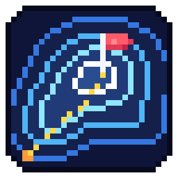

# Topo



Topo is a map viewer and editor for Celeste `.bin` maps, made for the **CEL (Desolo Zantas)** mod.
It uses the same Lönn plugins, autotiler and decals as the game, links live to a running Celeste and has a PCG room generator.

It was called **MT_Zenith** before, and **CEL Map Viewer** before that.

## Editions

Topo comes in two separate downloads:

- **Topo** (`Topo-<ver>-win-x64.zip`), the main download, has **no AI features**. The MCP server, agent panel and AI media tools aren't hidden or switched off: their code isn't in the exe at all.
- **Topo + AI** (`Topo-AI-<ver>-win-x64.zip`) is optional. It adds the MCP server and the ACP agent panel described under *AI* below. The window title says "Topo + AI", so you can always tell which one you're running.

Both editions share the same editor, PCG, live link, asset credits and settings folder.

## Requirements

- Windows 10/11 x64.
- Celeste with [Everest](https://everestapi.github.io/) installed. The CEL mod (`Mods/CEL` or another `Celestellaris` mod folder) is needed for CEL entities. Other maps open too, and vanilla assets come from the game.
- `Topo-<ver>-win-x64.zip` is self-contained, so you don't need .NET.
- `…-fxdependent.zip` is smaller but needs the [.NET 8 Desktop Runtime](https://dotnet.microsoft.com/download/dotnet/8.0) or newer.
- Optional, AI edition only: put `ffmpeg` on `PATH` (or set `CEL_FFMPEG`). Without it there are no video frame grabs or audio decoding for non-WAV files.
- Optional: the [PCGHelper](https://github.com/Magedeline/PCGHelper) mod in `Mods/PCGHelper` for procedural generation (or set `TOPO_PCGHELPER`, or use **PCG ▸ Locate PCGHelper…**).

## Install

1. Unzip anywhere and run `Topo.exe`. Topo is a standalone tool, not a mod; the `everest.yaml` in the zip only names and versions the download for Everest, Olympus and mod databases.
2. Topo looks for Celeste in this order:
   1. The folders above the exe. For example, a source build in `Celeste/Mods/CEL/Tools/CELMapViewer`.
   2. `CELESTE_DIR`.
   3. **File ▸ Set Celeste folder…**.
   4. Steam libraries.
   5. Olympus installs.
   6. Common install paths.
3. If it gets it wrong, use **File ▸ Set Celeste folder…** and restart.

To open the editor from inside the game with the `cel_mapviewer` console command or `/cel/editor/launch`, set `TOPO_EXE` to the full path of `Topo.exe`.

## Use

- **Open a map:** File ▸ Open (`Mods/CEL/Maps/CEL/...`).
- **Tools:** Select (V), Room (R), Brush (B), Rect (T), Fill (F), Line (L), Place (P) and Decal (D).
- **Screenshots:** File ▸ Screenshot ▸ Entire map (Ctrl+Shift+P), Selected room (Ctrl+Alt+P) or Current view. Also on the room right-click menus. Pick a scale (12.5%–4x), choose entities, triggers, borders, names and a transparent background, then save a PNG or copy it to the clipboard.
- **Assets ▸ Asset credits (Ctrl+Shift+K):** lists everything the map uses (decals, stylegrounds, tilesets, entities, triggers) with who to credit, a preview of each asset and a recommended next step. Installed mods are matched to their GameBanana page and author through [Maddie480's](https://maddie480.ovh) mod database; files in your own mod use the credits recorded in `Topo.credits.json` (mark them as your own work or credit someone), and unrecorded ones are matched against the Celeste Community Asset Drive. *Save credits.txt…* writes a release-ready credits file.
- **Assets ▸ Community Asset Drive:** browse maddie480.ovh's Asset Drive (decals, stylegrounds, tilesets, …) with the author's readme/terms, a *★ Recommended for this map* list that matches your map's themes, and *Add to my mod* that copies the file in and records its credit. *Import my own / other asset…* in the credits window brings in your own PNGs the same way. The AI gets the same data through the `asset_credits` MCP tool.
- **Room properties (Ctrl+R):** a Lönn-style dialog for new and existing rooms with name, position, size in tiles, colour, **camera offset X/Y**, wind, flags, checkpoint, music layers, music and ambience.
- **Fillers:** Room ▸ *Convert room's FG tiles to filler* turns a room's foreground tiles into filler rectangles and removes the room. *Convert fillers to rooms* does the reverse. Fillers are drawn hatched (View ▸ Fillers).
- **Project:** Choose Campaign, Choose Map, New Empty Project, New Standard Project (also creates dialog keys, decal/styleground/checkpoint folders and tileset xmls wired up through `meta.yaml`), Open Project, Resync Open Project, New map in campaign, Zip Mod.
- **Presets:** save the selected entities, triggers or decals as a preset, or as a **preset group** that keeps their relative positions. Place one from Presets ▸ Entities / Triggers / Preset Groups at the mouse. Presets are saved in `%APPDATA%\Topo\presets.json`.
- **Scripts:** runs the `Loenn/scripts` of installed mods (Loenn Scripts, Brokemia, Frost, Kyfex, Axo, Auroras and others) on the current room or on all rooms, with an arguments dialog. Lönn's script API is emulated, and the changes can be undone with Ctrl+Z. Scripts that need Lönn's own UI or its `$()` syntax report an error and leave the map unchanged. Entities and triggers that only have an Ahorn plugin (`Ahorn/entities/*.jl`) now show up in the palette too.
- **Live link:** Game ▸ Launch Celeste. Turn on Everest debug mode so the editor can teleport, reload and read the log on port 32270.
- **PCG ▸ Generate rooms (Ctrl+G):** the seleCte Markov generator with best-of-N candidates, artefact repair, a target difficulty tier, a mechanics filter, a movement-model check of every room, a preview, and **Train model…** to learn a new model from the open map or from installed collab maps of a tier.
- **PCG ▸ Restyle rooms (Ctrl+Shift+G):** rework the tiles of existing rooms with a seleCte model (surface detail, tileset swap, background) without moving them or touching fillers and other rooms. Exits, entities and the spawn are kept clear, and every room is checked so no exit or item gets harder. One undo step. In Topo + AI, **Hand to AI agent…** (or right-click a room) lets the agent restyle, compare, retune and hand-finish the rooms.
- **AI ▸ MCP server** (AI edition only): serves `http://localhost:32271/mcp` as `topo`. *AI ▸ Copy MCP client config* gives ready-to-paste snippets.
- **AI tab (Ctrl+Shift+A, AI edition only):** runs an ACP agent (Claude, Codex, Copilot, Gemini…) against the open map. You can attach images, audio and video.
  - **Strongest effort** switches the agent to its most capable model and highest effort, auto-allows the map tools, prepends a build-and-verify directive to every prompt and continues automatically when a turn limit stops the agent.
  - **Permissions** chooses how the agent's permission requests are answered: ask, auto-allow map tools (edits are undoable), or auto-allow all.
  - **Design ▾** inserts a workflow prompt: build a complete level, design a few rooms, generate with PCG and refine, review difficulty, polish.
- **Headless:**
  - `Topo.exe --mcp [--map file.bin] [--read-only] [--port N]` (AI edition only)
  - `--mcp-bridge [url]` (AI edition only)
  - `--selftest`

Settings, caches and custom PCG models live in `%APPDATA%\Topo`. Topo was called MT_Zenith (and before that CEL Map Viewer): on first run it copies the settings, presets and PCG models from `%APPDATA%\MT_Zenith` (or `%APPDATA%\CELMapViewer`).

## Agent tools (MCP, AI edition only)

Besides reading, rendering and editing rooms, tiles and entities, the `topo` server gives an agent what it needs to build a complex map and know that it works:

| Area | Tools |
|---|---|
| Build | `build_room` (a whole room in one call: placement by attaching to another room's side, size tier, fill, fg/bg rows or draw ops, carved exits, entities, auto spawn, analysis), `draw_tiles` (rect, outline, lines, flood fill, stairs, platforms, exits, replace), `connect_rooms` (matching openings between touching rooms), `duplicate_room` (with mirroring), `batch` (several tools as one undo step with rollback) |
| Verify | `analyze_room` (movement-model reachability: jump, fall, one dash, climb with stamina, wall jumps, swimming, springs/boosters/feathers, rides and flings off zip movers and moving platforms; lethal spikes/spinners/lightning; which exits and items are reachable, min tech per exit, hazard pressure, routes, overlay image), `analyze_map` (openings connected / blocked / void, rooms reachable and traversable from the start, rooms that need advanced tech), `validate_map`, `compare_to_tier` |
| See | `view_map` (the map as the editor canvas draws it, with real entity sprites: the whole map, one room with its surroundings, a world area, or `target: "view"` for exactly what you are looking at in the window, selection outlined; comes with a legend of room rectangles in image pixels), `editor_state` (camera, zoom, rooms in view, tool, layer, selection, palette pick) |
| Hand-craft | `add_entity` / `build_room` entities with `rest: floor/ceiling/left/right` (the item is set down on the surface from the given point, like placing it by hand, and shows up selected in the editor), `placement_memory` (every pick the agent places is remembered across maps in `%APPDATA%\Topo\ai_placements.json`: how often, on which surface, with which attributes, plus notes it leaves for itself; a digest is shown to the agent every turn) |
| Presets | `list_presets`, `save_preset` (items of a room by ids or area, saved as a preset group), `place_preset`, `delete_preset`: the same presets as the *Presets* menu, so groups the agent saves are yours to place and the other way round |
| Plan | `design_notes` (concept, tier, plan, todo, log kept beside the map as `<map>.design.json` and shown to the agent every turn), prompts `build_map`, `design_level`, `pcg_level`, `fix_room`, `review_difficulty`, `polish_map` |
| PCG | `pcg_models`, `pcg_generate` (candidates, repair, tier, mechanics, preview, per-room judgement), `pcg_import`, `pcg_restyle` (rework existing rooms' tiles, routes kept), `pcg_train` (new Markov models from the open map or reference maps of a tier) |
| Reference | `list_reference_maps`, `study_reference_map`, `difficulty_profile` (statistics of installed collabs per tier) |
| Game & media | `game_*` (teleport, reload, screenshot, log), `list_media`, `view_image`, `compare_images`, `analyze_audio`, `analyze_video` |

The movement model is an approximation of Celeste physics (jump ≈ 3 tiles up / 6 across, dash ≈ +4 tiles, stamina ≈ 10 tiles of climbing), not a simulation: it catches unreachable exits, missing ground and blocked openings, and tells which exits need a dash or advanced tech, but a human playtest still decides the feel.

## Building

```
dotnet build CELMapViewer.csproj                    # Topo + AI (default for development)
dotnet build CELMapViewer.csproj -p:TopoAi=false  # standard edition, no AI code
pwsh ./publish.ps1 -SelfTest                        # all release zips (both editions) -> dist/
```

`-p:TopoAi=false` leaves out `MainForm.Ai.cs` and the AI-only files in `Agent/` (MCP server, ACP client, agent panel, map tools, prompts, media analysis). `RoomAnalysis`, `MapGraph`, `ReferenceMaps` and `ToolException` also live in `Agent/` but are ordinary editor logic used by PCG, so both editions include them.

Releases are built by `.github/workflows/release.yml` when a `v<version>` tag is pushed (bump `<Version>` in `CELMapViewer.csproj`).

This repository is the standalone copy of `Tools/CELMapViewer` from the CEL mod ([Magedeline/CEL](https://github.com/Magedeline/CEL)). To develop against the mod, clone it into `Celeste/Mods/CEL/Tools/CELMapViewer` or set `CELESTE_DIR`.

## License

Topo is released under the [MIT License](LICENSE). Bundled third-party software (MoonSharp, the .NET runtime) is listed in [THIRD-PARTY-NOTICES.txt](THIRD-PARTY-NOTICES.txt). Celeste's assets and mod assets are not included; they are read from your own install and belong to their creators.
